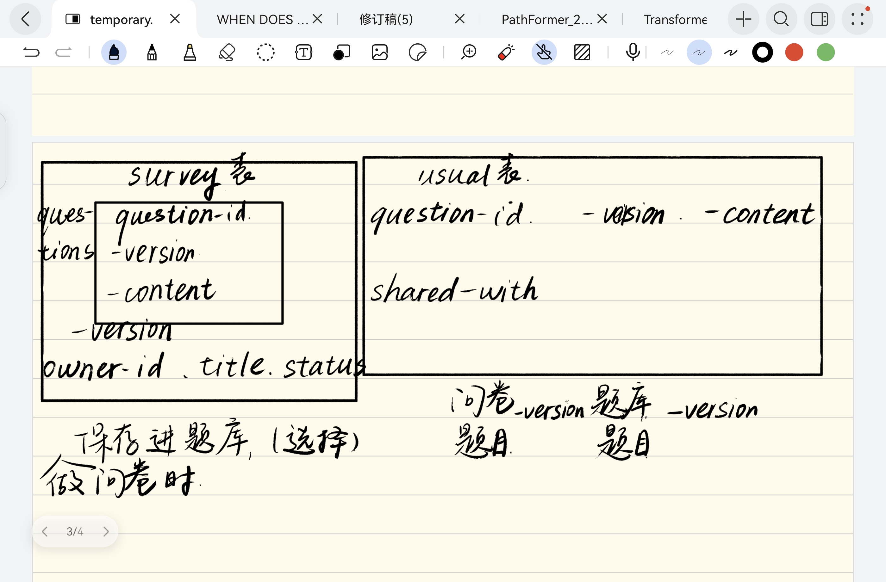

# 第二阶段AI使用日志

工具：Codex、PowerShell、Python、MongoDB、Pytest、Playwright/Chrome；报告使用ReportLab与Poppler。

以下按本聊天的消息顺序记录26条用户输入。引用块保留用户原文；确认项分别列出当时问题与用户答复。每条下方的结果和修改为实施记录。附件随日志保存。

## P01 阅读需求并逐项实施

**工具：** Codex。

**用户消息原文：**

> 现在我们参照这个文件的要求完成这个作业的第二个阶段，需求变更，每一个要求的实现都应该先观看文档然后在开始制作。每一个任务的完成都应该是遵循以下的步骤，先看文档，制定todo，然后按照步骤一步一步做

**用户所附文档：** [需求变更原文.docx](素材/需求变更原文.docx)。

**结果：** 形成第二阶段待办并在第一阶段代码上实现八项变更。

**是否修改及内容：** 是。扩展题目复用、共享、版本历史、引用、题库及统计。

## P02 确认跨卷统计范围

**工具：** Codex。

**当时问题：**

> 共享题目的跨问卷统计，你希望覆盖哪些问卷？我会先按第一阶段“只能查看自己问卷统计”的规则实现；这个选择会影响第八项的统计权限。

**用户答复原文：**

> 只汇总当前用户自己的所有问卷（保留原权限规则）

**结果：** 确定统计只覆盖当前用户自己的问卷。

**是否修改及内容：** 是。跨卷查询按问卷所有者过滤。

## P03 要求解释实现方法

**工具：** Codex。

**用户消息原文：**

> 详细告诉我你每一个任务分别是采取什么方式做完的？

**结果：** 按任务说明实现方式和对应模块。

**是否修改及内容：** 否。本条为实现说明。

## P04 结合第一阶段重新完成材料

**工具：** Codex。

**用户消息原文：**

> 结合这个文档重新完成阶段二的任务，重新书写要上交的文档

**用户所附文档：** [第一阶段任务原文.docx](素材/第一阶段任务原文.docx)。

**结果：** 重新核对两阶段规格和提交要求。

**是否修改及内容：** 是。补充设计、测试与报告内容。

## P05 精简提交内容

**工具：** Codex。

**用户消息原文：**

> 你现在提交的东西实在是太冗余了，精简你要提交的东西，只保留必要的，整合md文档，文字需要精炼有内容

**结果：** 压缩重复文档和结果副本。

**是否修改及内容：** 是。整合说明并精简正式交付。

## P06 比较前后数据库

**工具：** Codex。

**用户消息原文：**

> 我们现在来分析你做的改动，把之前的数据库样子和现在数据库样子画图做出一个对比

**结果：** 说明第一阶段嵌入题目与第二阶段独立题目版本的结构差异。

**是否修改及内容：** 否。本条为数据库比较与图示说明。

## P07 询问题目共享机制

**工具：** Codex。

**用户消息原文：**

> **二、希望可以把题目分享给别人使用**
> 
> 用户反馈：
> 
> 我们一个团队经常一起做问卷，希望我做好的题目可以给同事用。\
> &#x20;现在只能复制粘贴，很麻烦。
> 
> 期望效果：
> 
> - 可以把题目共享给其他用户     &#x20;
> - 其他用户可以在自己的问卷里使用这些题目     &#x20;
> - 共享后仍然可以继续使用同一个题目     &#x20;
> 
> 示例：
> 
> 老师做的题目，学生可以直接拿来用
> 
> 这个是怎么实现的？

**结果：** 解释按账号授权与问卷引用具体版本的流程。

**是否修改及内容：** 否。本条为共享机制说明。

## P08 询问冻结与引用影响

**工具：** Codex。

**用户消息原文：**

> **六、希望能查看某个题被哪些问卷使用**
> 
> 用户反馈：
> 
> 我想修改一个题，但不知道哪些问卷在用它，\
> &#x20;改完怕影响别人的问卷。
> 
> 期望效果：
> 
> - 可以查看题目被哪些问卷使用     &#x20;
> 
> &#x20; 修改时可以决定是否创建新版本   为什么会影响已经做好的问卷，这不是被冻结了吗

**结果：** 区分发布快照、题目版本和草稿引用。

**是否修改及内容：** 否。本条为版本影响范围说明。

## P09 提出数据库草图

**工具：** Codex。

**用户消息原文：**

> 这是我设计的数据库，你不觉得应该这样子设计吗？在每个问卷里面需要有一个版本，这个版本不光记录了问题的版本，也记录了问卷的版本，常用题库里面记录的是问题和版本，然后应该再开一个question表，专门记录各个问题的修改以及其修改之后的版本，里面是question-id和version

**用户所附原图：**

**结果：** 以用户草图为依据讨论题目历史和问卷双版本。

**是否修改及内容：** 是。后续模型改为独立题目ID/版本和问卷ID/版本。

## P10 要求依原设计重写后端

**工具：** Codex。

**用户消息原文：**

> 是的，我们现在按照这个数据库重新编写后端，在第一版的基础上重新编写代码，按照我们的设计来做

**结果：** 准备按确认设计在第一阶段后端上修改。

**是否修改及内容：** 是。后续拆分内容、收录、授权与问卷版本模块。

## P11 先列完整数据库

**工具：** Codex。

**用户消息原文：**

> 你先把完整的数据库罗列出来让我确认

**结果：** 列出当时的七集合方案供确认。

**是否修改及内容：** 否。先列数据库，随后再实施；命名题库在后续消息中取消。

## P12 多选与用户名转发

**工具：** Codex。

**用户消息原文：**

> 当我先要把问题转发给其他人并且能够支持多选的时候，我应该怎么做？这个是不是在后端实现的？如果是，给出一个...的按钮，然后选择多选或者转发，转发形式是输入用户名。需要支持直接转发问题库和题库里面选择的问题

**结果：** 增加更多菜单、单题/多选和按用户名转发。

**是否修改及内容：** 是。前端操作调用后端批量授权接口。

## P13 确认方案与原作者转发权限

**工具：** Codex。

**当时问题：**

> 是否确认上一条列出的 7 个集合方案，并将“多选／转发”一起实现到新版后端？

**用户答复原文：**

> 确认，按新版方案实现

**当时问题：**

> 收到别人共享的题目后，接收者能否继续转发？

**用户答复原文：**

> 仅题目作者可转发，接收者只能使用

**结果：** 确认当时方案，并限定接收者不能再转发原题。

**是否修改及内容：** 是。加入原作者授权检查；后续按取消命名题库的确认调整为六集合。

## P14 继续实施

**工具：** Codex。

**用户消息原文：**

> 继续

**结果：** 继续已确认的实现、测试和文档工作。

**是否修改及内容：** 是。完成相关版本与共享流程。

## P15 模块化、保留草稿与版本选择

**工具：** Codex。

**用户消息原文：**

> 基于题目生成新问卷的时候，应该将原来的问卷留作草稿，跳转到新问卷显示。在一个问卷里面检测问题，如果发现问题有版本可以切换，那么就在这个问题旁边显示一个按钮让用户选择切换到哪一个版本，在选择的时候每一个版本的内容都需要显示。其实我感觉你设计的还是很烂啊。把每一部分的表都看作是一个模块，要是需要那个模块就直接发出请求，每一个问卷和用户就是权限不同罢了

**结果：** 按资源拆分模块，增加保存源稿、打开新稿与完整版本预览。

**是否修改及内容：** 是。统一权限并实现逐题切版，后续依新要求改为整卷下一版本。

## P16 确认保留编辑中的草稿

**工具：** Codex。

**当时问题：**

> “保留原问卷为草稿”我暂按这个流程理解：编辑中的问卷先保存为草稿，再用所选题目创建一份新问卷并打开；已发布问卷继续保留原状态和答卷。是否符合你的意思？

**用户答复原文：**

> 符合，保留编辑中的草稿

**结果：** 确定先保留当前编辑草稿，发布卷与答卷保持原状态。

**是否修改及内容：** 是。新建前先保存编辑中的草稿。

## P17 询问启动后端

**工具：** Codex。

**用户消息原文：**

> 如何启动后端

**结果：** 提供MongoDB和应用的启动命令及访问地址。

**是否修改及内容：** 否。本条为运行说明。

## P18 要求新旧问卷均可修改

**工具：** Codex。

**用户消息原文：**

> 发生了错误。正确的想法应该是基于这一道题目创建新问卷。旧问卷和新问卷都应该可以被修改

**结果：** 纠正来源题只读与新旧草稿不可直接改题的问题。

**是否修改及内容：** 是。两份草稿可编辑，保存时新增题目版本并更新本版引用。

## P19 要求保留其余题目

**工具：** Codex。

**用户消息原文：**

> 在使用这道题目创建新问卷的时候，除了依据的这道题目，也要保留剩下的题目

**结果：** 将创建流程改为保留全部题目、顺序和规则。

**是否修改及内容：** 是。整卷复制而非仅复制依据题。

## P20 明确新卷是原卷下一版本

**工具：** Codex。

**用户消息原文：**

> 新创建的这个问卷就是原来的问卷的下一个版本了

**结果：** 沿用survey_id、递增survey_version并记录parent_version。

**是否修改及内容：** 是。允许同一逻辑问卷的多个草稿版本并存。

## P21 明确同源分组、主动入库与删除

**工具：** Codex。

**用户消息原文：**

> 现在发现一个问题：在设计题库的时候，应该把相同题目源，不同版本的题目放在一起。只有当用户显式点击放入题库的时候才把其放入题库，题库存的是一个一个具体的题目，不要联合存放。并且需要支持删除

**结果：** 分离内容历史、共享授权与用户收录。

**是否修改及内容：** 是。仅显式入库，同源版本分组，支持单版/整题收录移除。

## P22 确认取消命名题库

**工具：** Codex。

**当时问题：**

> 你说的“题库存一个个具体题目，不要联合存放”，是否要取消现在的命名题库（例如“人口调查题库”）？

**用户答复原文：**

> 取消命名题库，只保留单题题库

**结果：** 确定取消命名题库，保留单题题库。

**是否修改及内容：** 是。停用命名题库模块，旧数据归档，活动集合调整为六个。

## P23 仿照第一阶段编写并清理

**工具：** Codex。

**用户消息原文：**

> 仿照第一阶段提交材料来编写第二阶段提交材料，问题要一个一个的写。需要简洁精炼，不要有防御性内容。写完之后清理文件夹，删除多余的内容

**结果：** 按第一阶段四类目录重排并重写材料。

**是否修改及内容：** 是。迁移测试入口并完整运行187项，清理旧交付副本和过程文件。

## P24 要求论文形式

**工具：** Codex。

**用户消息原文：**

> 最后的报告需要时论文形式的

**结果：** 将报告调整为论文式正文。

**是否修改及内容：** 是。此后继续依第一阶段原报告结构修订。

## P25 要求保留第一阶段全部结构

**工具：** Codex。

**用户消息原文：**

> 要求式和原本1一样的格式，包括目标和需求分析，等全部的内容，只不过在写着一个的时候目标和需求和原来的不同，其余的都是相同的

**结果：** 核对第一阶段八个主章节及全部原有小节。

**是否修改及内容：** 是。本次恢复原有章节顺序，以第二阶段内容填充。

## P26 要求论文字体、表格和完整消息日志

**工具：** Codex。

**用户消息原文：**

> 在第二阶段提交材料里面，pdf里面字体和表格改成论文形式。AI使用日志需要完全按照我发给你的消息来做。包括图片和内容

**结果：** 对照原PDF修订字体和三线表，并从聊天记录提取26条用户消息与原图。

**是否修改及内容：** 是。日志逐条保留原话、确认答复、图片及实施记录，报告和压缩包同步更新。
